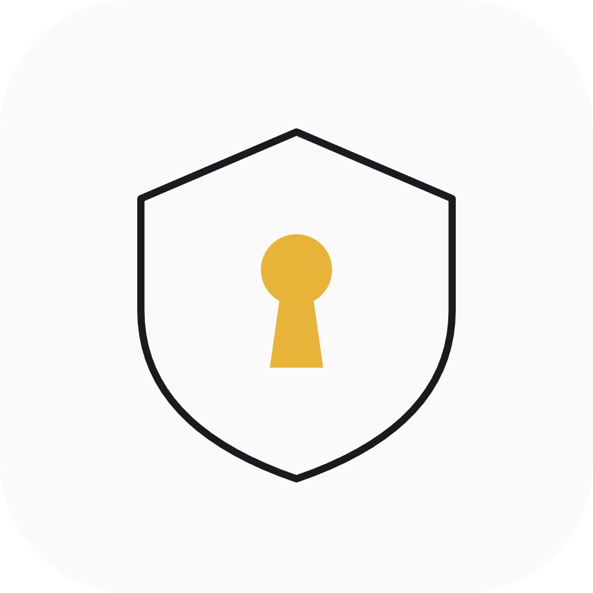
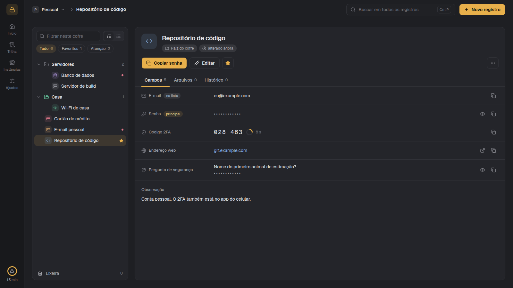
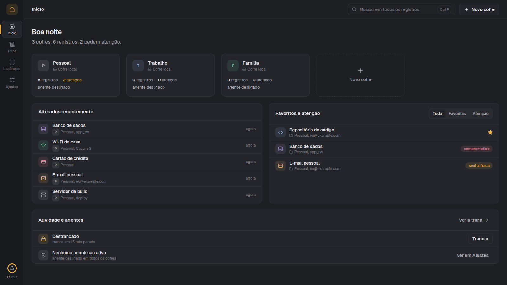
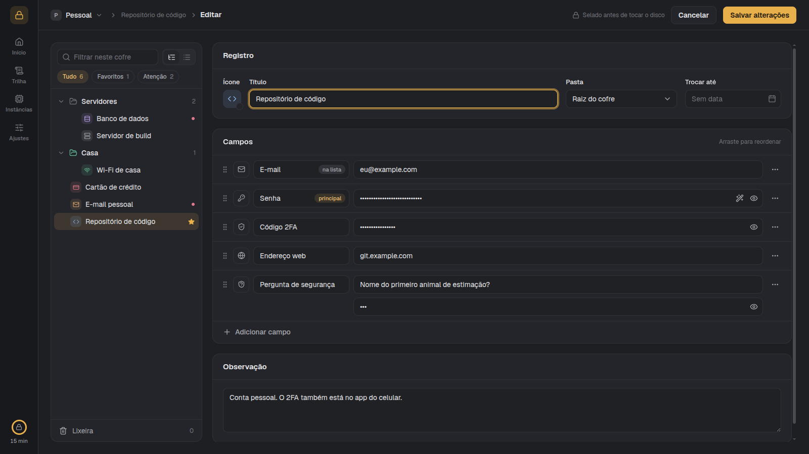

<div align="center">



# Keyhold

**Your passwords, on your machine, in a window that is pleasant to use.**

No server, no account, no subscription. One program, one encrypted file, and your browser as the screen.



</div>

---

## Why Keyhold

Password managers usually ask you to trust a company with a copy of everything. Keyhold doesn't
have a company to trust: it keeps your vault in a single encrypted file on your computer, opens it
with your master password, and forgets the key the moment you lock it or close it.

- **Everything stays here.** No sync, no telemetry, no update check, nothing fetched from the
  internet. If your connection is down, Keyhold works exactly the same.
- **Records shaped like your life, not like a form.** A record is a title, an icon and the fields
  it needs: e-mail, password, 2FA code, PIN, card, security question, notes, and more. Nothing is
  forced on you.
- **Your coding assistant can use a secret without reading it.** Claude Code can run a command with
  a password in its environment, after asking you, so the password never lands in a chat.
- **Optionally, a vault in AWS Parameter Store.** For teams that already keep credentials there, a
  friendly window over the same parameters, with access still decided by IAM.

> **Status: young, and honest about it.** Keyhold is tested and reviewed, but it has not had an
> independent audit. Keep a copy of anything important somewhere else too.

## Get started

Keyhold runs on **Linux**, **macOS** and **Windows**; every change is tested on all three.

You need [Rust](https://rustup.rs) and [Node](https://nodejs.org). Node is only used to build the
interface, which is then baked into the program.

**Linux and macOS**

```bash
git clone https://github.com/danielbbarcelos/keyhold
cd keyhold
./install.sh
```

That builds Keyhold and puts it in `~/.local/bin`. On Linux it adds **Keyhold** to your app
launcher; on macOS it makes `~/Applications/Keyhold.app`, which Launchpad and Spotlight find.

**Windows** (PowerShell)

```powershell
git clone https://github.com/danielbbarcelos/keyhold
cd keyhold
powershell -ExecutionPolicy Bypass -File .\install.ps1
```

That puts `keyhold.exe` in `%LOCALAPPDATA%\Programs\Keyhold` (on your PATH) and adds **Keyhold**
to the Start menu. Your vault lives in `%LOCALAPPDATA%\Keyhold`.

Run the installer again any time to upgrade.

Then open Keyhold from the launcher (or run `keyhold`). The first time, it asks you to choose a
master password and shows a **recovery key**: write it down somewhere safe. With neither of them,
nobody can open the vault, not even you.

<details>
<summary>Other ways to build and run</summary>

```bash
(cd web && npm install && npm run build)
cargo build --release
./target/release/keyhold
```

```
keyhold              # start Keyhold and open it in the browser
keyhold --no-browser # start without opening a browser
keyhold --present    # bring a running Keyhold forward (or start one)
keyhold --port 9000  # use another port (the default is 7717)
keyhold where        # show where the vault file lives
```

| Installer setting | Effect |
|---|---|
| `SKIP_BUILD=1` | use the interface already built in `web/dist` |
| `SKIP_DESKTOP=1` | do not add the launcher entry |
| `BIN_DIR=…` | install somewhere other than `~/.local/bin` |
| `--with=set-host[=NAME]` | also give Keyhold a friendly address, see below |

</details>

## A quick tour



- **Início** shows your vaults, what you opened recently, your favourites and anything that needs
  attention (weak, repeated or old passwords, a "change by" date that has passed).
- **Inside a vault**, the folders and records stay on the left as a tree or as a flat list. Filter
  by **Favoritos** or **Atenção**, drag records between folders, and find the trash at the bottom.
- **A record** shows each field the way it should be shown: a live 2FA code with its countdown, a
  web address you can open, a security question with the answer hidden. Revealing a secret lasts
  20 seconds; copying one clears the clipboard after 30.
- **Editing** happens on the page, with the tree still beside you. Add fields of any of the 15
  kinds, drag them into order, pick an icon (or use a picture of your own), and mark which field
  shows under the title and which one the main button copies.
- **Ctrl P** searches every vault by title, never by secret.
- **Right-click, Ctrl click or the middle button** opens a vault, folder, record or screen in a new
  tab of the same session.
- **Trilha** is the trail of what happened: unlocks, changes, and (if you turn it on) every reveal
  and copy. Each line carries the fingerprint of the one before, so editing the trail breaks it.
- **The lock** at the bottom of the rail shows how long until Keyhold locks itself. Locking forgets
  the key and clears the clipboard. With an AWS sign-in active, the rail also shows when it expires.
- **Each vault** can wear an icon or a picture of your own, like a record.

Grafite (dark) and Claro (light) themes, four accent colours and the content width (whole window or
centred) are in **Ajustes → Aparência**.



## Two kinds of vault

| | **Local vault** | **AWS Parameter Store vault** |
|---|---|---|
| Where the secrets live | an encrypted file on this computer | parameters in one AWS account (`SecureString`, KMS) |
| Who can read them | whoever has your master password | whoever IAM allows, in the console, the CLI or Keyhold |
| Works offline | yes | no: without network or session, the vault is unavailable |
| Deleting | goes to the trash first | permanent (Parameter Store has no trash) |
| History | every version, kept in the file | the last 100 versions, kept by AWS |
| Attachments | inside the encrypted file | in an S3 bucket you name, encrypted with KMS |
| A coding assistant | can be allowed, per vault, per secret | not yet |

A local vault is the default and the one Keyhold is built around. An AWS vault is the one, narrow
exception to "nothing leaves your machine": only that vault's content goes out, and only to the
account it names. The [threat model](docs/THREAT_MODEL.md) says exactly what each one protects.

### Using AWS Parameter Store

1. **Ajustes → Contas AWS → Adicionar login SSO.** Enter your AWS access portal address and its
   region. Keyhold shows a code and opens the AWS page; confirm the code there. The session lives
   only in memory: after Keyhold restarts or locks, press **Renovar**.
2. **Adicionar conta deste login.** Pick the account and the role Keyhold should use.
3. **Novo cofre → AWS Parameter Store.** Choose the account, the region, and the S3 bucket for
   attachments (Keyhold suggests `keyhold-<vault name>` and never creates it).

Every `/` in a parameter name is a folder. Titles and folder names can be anything except `/`: the
parameter name is made from them (`Banco Inter (PJ)` becomes `banco-inter-pj`), shown as "Na AWS"
while you type, and editable when you want your own. Renaming offers to move the parameter too,
which loses its history; each AWS vault sets whether that box starts ticked. A record with a single password is stored as that plain
value, so your applications keep reading it as before; a record with more fields, or with notes,
becomes Keyhold's JSON. Keyhold only writes `SecureString` parameters, keeps the KMS key a
parameter already uses, and refuses to save over a change someone else made in the meantime.

The role needs `ssm:GetParametersByPath`, `ssm:GetParameter`, `ssm:GetParameterHistory`,
`ssm:DescribeParameters`, `ssm:PutParameter`, `ssm:DeleteParameter`,
`ssm:ListTagsForResource`, `ssm:AddTagsToResource`, `ssm:RemoveTagsFromResource`, the matching
`kms:Decrypt`/`kms:Encrypt`/`kms:GenerateDataKey`, and for attachments `s3:ListBucket`,
`s3:GetObject`, `s3:PutObject`, `s3:DeleteObject` on the bucket. Read-only roles work too: Keyhold
shows what it can read and says so when a save is refused.

Good to know: parameter **names, folder paths and titles** are metadata AWS keeps unencrypted, and
anyone allowed to describe parameters in the account can see them. Values and notes are encrypted.

### Moving things between vaults

**Copiar para…** (on a vault, a folder or a record) copies into any other vault and folder,
local or AWS, in either direction. The original stays where it is until you choose, at the end,
to delete it. Going to AWS, Keyhold first shows the parameter names it will create; a name already
taken asks you whether to rename, overwrite or skip; and a copy interrupted by an expired session
continues from where it stopped. Only the current version is copied: the history stays with the
original.

## Letting Claude Code use a secret

```bash
claude mcp add keyhold --scope user -- ~/.local/bin/keyhold mcp
```

Then turn it on in **Ajustes → Agentes** and choose which vaults the assistant may see. From then
on, every request stops and asks you, naming the process that asked and the field it wants, and
how long the yes should last (just this once, while that assistant is open, or a fixed window).

The preferred way never shows the secret to the model at all:

```bash
keyhold run "Banco de dados" Senha -- psql "postgres://deploy@localhost/app"
```

The password goes into that command's environment; the assistant only sees the command's output.
When you need the password yourself, the assistant can put it on your clipboard instead. Reading a
value straight into the chat is off unless you switch it on, and for a 2FA field the assistant only
ever gets the current code, never the secret behind it.

## A friendlier address

Linux and macOS only, for now.

```bash
sudo ~/.local/bin/keyhold set-host            # keyhold.local
sudo ~/.local/bin/keyhold set-host --remove   # undo
```

This adds one line to `/etc/hosts` so Keyhold also answers at `https://keyhold.local:7717`. With
[mkcert](https://github.com/FiloSottile/mkcert) installed, it also makes an HTTPS certificate,
running mkcert as you, not as root. If mkcert's local authority is not installed yet, Keyhold asks
first and explains why: that authority is trusted by your browsers for every site, so it is your
call. Without HTTPS, browsers refuse the clipboard on a name other than 127.0.0.1.

Only names that can never exist on the internet are accepted (`.local`, `.localhost`, `.internal`,
`.test`, `.home.arpa`), and Keyhold refuses requests addressed to any other name.

(`sudo` needs the full path because `~/.local/bin` is not on its search path.)

## What Keyhold promises, and what it doesn't

**It promises:**

- The vault file is unreadable without your master password: a copied backup is noise.
- The key exists only while the vault is open, in memory, and is wiped on lock or exit.
- Keyhold only listens to your own computer, carries everything it shows inside the program, and
  never contacts anything, except an AWS vault talking to its own account.

**It can't promise:**

- If your computer is already compromised, Keyhold loses: a keylogger catches the master password,
  and a program running as you can read memory while the vault is open.
- A revealed password is revealed: screenshots and cameras are out of any program's reach.
- Lose both the master password and the recovery key, and the data is gone. There is no reset.

The full reasoning is in [docs/THREAT_MODEL.md](docs/THREAT_MODEL.md), and the security design in
short is: AES-256-GCM with each record bound to its own id and version, Argon2id for the master
password, a strict Content-Security-Policy enforced by a test, and no web storage in the interface.

## Where things are kept

On Linux and macOS (on Windows, the same three folders are under `%LOCALAPPDATA%\Keyhold`, and the
agent talks through a named pipe instead of a socket):

| Path | What |
|---|---|
| `~/.local/share/keyhold/vault.db` | the vault: ciphertext only. **This is the file to back up.** |
| `~/.local/state/keyhold/` | the agent socket and the launcher's log |
| `~/.config/keyhold/` | preferences and the optional HTTPS certificate; never a secret |

## Development

```bash
cargo test               # the gate: includes the hardening and HTTP-surface checks
cd web && npm run build  # rebuild the interface that gets embedded
cd web && npm run dev    # interface with hot reload
```

What changed in each version is in [CHANGELOG.md](CHANGELOG.md); what is planned is in
[docs/ROADMAP.md](docs/ROADMAP.md).

## Licence

MIT. See [LICENSE](LICENSE).
